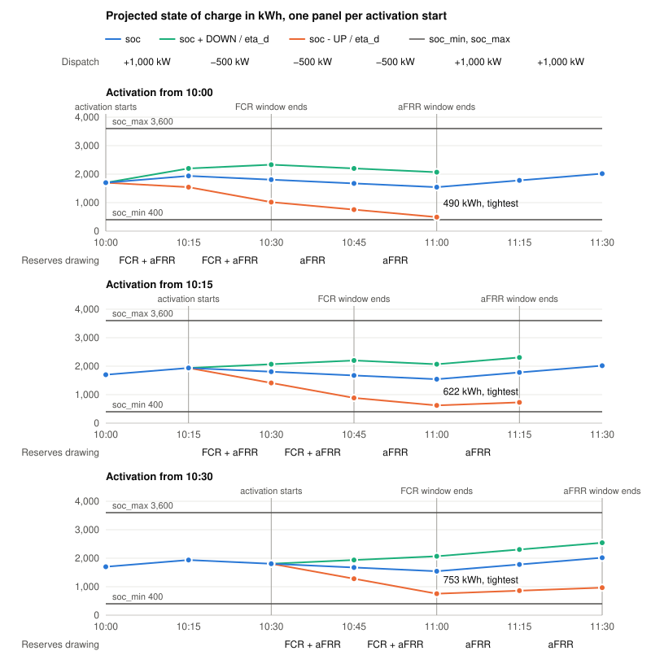

# Activation windows and state of charge projection

A battery must be able to deliver a full activation of every reserve it holds, on top of
its wholesale plan. The model checks this by projecting the state of charge along an
activation path that starts at every step.

## Planned state of charge

```text
soc[t] = soc[t - 1] + (input_power[t] * eta_c - output_power[t] / eta_d) * dt
```

- `soc[t]` is the state at the end of step `t`. It includes every planned wholesale flow.
- Before the first step, `soc` is `soc_start`, see
  [initial state of charge projection](initial_soc_projection.md).

## Power headroom

```text
dispatch[t] = input_power[t] - output_power[t]

output_ancillary[t] - dispatch[t] <= max_discharge_power[t]
input_ancillary[t]  + dispatch[t] <= max_charge_power[t]
```

- `output_ancillary` and `input_ancillary` sum the asset's upward and downward shares over
  every reserve it serves.
- Wholesale dispatch and reserves share the same power: charging frees upward room and
  takes downward room.

## Activation path

Reserve `m` holds `up[m][t]` and `down[m][t]` on the asset and has an activation window of
`W[m]` steps. An activation starting at step `s` draws, at offset `j`:

```text
up_energy[s][j]   = sum over m with j < W[m] of up[m][s + j]   * dt
down_energy[s][j] = sum over m with j < W[m] of down[m][s + j] * dt

UP[s][j]   = up_pending   + up_energy[s][0]   + ... + up_energy[s][j]
DOWN[s][j] = down_pending + down_energy[s][0] + ... + down_energy[s][j]
```

For every start `s` and every offset `0 <= j < max W[m]`, cut at the end of the horizon:

```text
soc[s + j] - UP[s][j]   / eta_d >= soc_min[s + j]
soc[s + j] + DOWN[s][j] / eta_d <= soc_max[s + j]
```

- A path starts at every step, not only where a product starts: an activation can come at
  any time while a reserve is held. At each step, it draws only what is held then.
- Each reserve draws only within its own window. Energy already drawn stays drawn until
  the longest window ends: no recovery is assumed.
- The activation is projected on the planned `soc`, so wholesale trades during the window
  count.
- `1 / eta_d` in both directions never underestimates and needs no binaries, see
  [ancillary energy](ancillary_energy.md).
- `up_pending` and `down_pending` are the activations of the step in progress at run time.
  They apply to every path.

## Example

Battery: 2,000 kW each way, `soc_min` 400 kWh, `soc_max` 3,600 kWh, `eta_c = eta_d = 0.95`,
`soc_start` 1,700 kWh, no pending activation, 15 min steps.

| Asset share of | Held | Up | Down | Window |
|---|---|---|---|---|
| FCR (symmetric) | 08:00-12:00, one 4 h product | 1,000 kW | 1,000 kW | 30 min, 2 steps |
| aFRR energy | 10:00-12:00 | 500 kW | 0 kW | 60 min, 4 steps |

| Step | Day-ahead 1 h | IDC 15 min | IDC 30 min | dispatch |
|---|---|---|---|---|
| 10:00 | buy 1,000 kW | | | +1,000 kW |
| 10:15 | buy 1,000 kW | sell 1,500 kW | | -500 kW |
| 10:30 | buy 1,000 kW | | sell 1,500 kW | -500 kW |
| 10:45 | buy 1,000 kW | | sell 1,500 kW | -500 kW |
| 11:00 | buy 1,000 kW | | | +1,000 kW |
| 11:15 | buy 1,000 kW | | | +1,000 kW |

```mermaid
gantt
    title Wholesale plan, reserves held, and three activation paths
    dateFormat HH:mm
    axisFormat %H:%M

    section Wholesale plan
    Day-ahead 1 h buy 1000 kW         : 10:00, 60m
    Day-ahead 1 h buy 1000 kW         : 11:00, 60m
    IDC 15 min sell 1500 kW           : 10:15, 15m
    IDC 30 min sell 1500 kW           : 10:30, 30m

    section Reserves held
    FCR 4 h block 1000 kW up and down : 10:00, 120m
    aFRR 500 kW up                    : 10:00, 120m

    section Activation from 10:00
    FCR draws, 30 min window          : 10:00, 30m
    aFRR draws, 60 min window         : 10:00, 60m

    section Activation from 10:15
    FCR draws, 30 min window          : 10:15, 30m
    aFRR draws, 60 min window         : 10:15, 60m

    section Activation from 10:30
    FCR draws, 30 min window          : 10:30, 30m
    aFRR draws, 60 min window         : 10:30, 60m
```



**Headroom.** Upward reserve is 1,500 kW and downward is 1,000 kW, so `dispatch` must stay
within -500 kW and +1,000 kW. Both limits bind in this plan: downward at 10:00 and from
11:00, upward from 10:15 to 11:00.

**Activation paths.** One path starts at every step. The three below start at 10:00, 10:15,
and 10:30.

<picture>
  <source media="(prefers-color-scheme: dark)" srcset="assets/soc_projection_dark.svg">
  
</picture>

Every path draws the same energy here, as the reserves held are constant:

| kWh, offset `j` | 0 | 1 | 2 | 3 |
|---|---|---|---|---|
| up drawn, FCR + aFRR | 250 + 125 | 250 + 125 | 0 + 125 | 0 + 125 |
| `UP` | 375 | 750 | 875 | 1,000 |
| down drawn, FCR | 250 | 250 | 0 | 0 |
| `DOWN` | 250 | 500 | 500 | 500 |

`soc_min` is 400 kWh and `soc_max` is 3,600 kWh throughout:

| kWh, at | 10:00 | 10:15 | 10:30 | 10:45 | 11:00 | 11:15 | 11:30 |
|---|---|---|---|---|---|---|---|
| `soc` | 1,700 | 1,938 | 1,806 | 1,674 | 1,543 | 1,780 | 2,018 |
| from 10:00, `soc + DOWN / eta_d` | 1,700 | 2,201 | 2,332 | 2,201 | 2,069 | | |
| from 10:00, `soc - UP / eta_d` | 1,700 | 1,543 | 1,016 | 753 | **490** | | |
| from 10:15, `soc + DOWN / eta_d` | | 1,938 | 2,069 | 2,201 | 2,069 | 2,307 | |
| from 10:15, `soc - UP / eta_d` | | 1,938 | 1,411 | 885 | **622** | 728 | |
| from 10:30, `soc + DOWN / eta_d` | | | 1,806 | 1,938 | 2,069 | 2,307 | 2,544 |
| from 10:30, `soc - UP / eta_d` | | | 1,806 | 1,280 | **753** | 859 | 965 |

- FCR is held until 12:00, but each path draws it only for its first 30 min. Later paths
  cover the rest of the product.
- Every path is tightest at 11:00, the end of the IDC sales. The day-ahead charge from
  11:00 lifts the checks after it.
- The path from 10:00 binds: 490 kWh, 90 kWh above `soc_min`. With `soc_start` 1,600 kWh
  it fails at 390 kWh, and the optimizer would have to sell less on IDC or hold less
  reserve.
