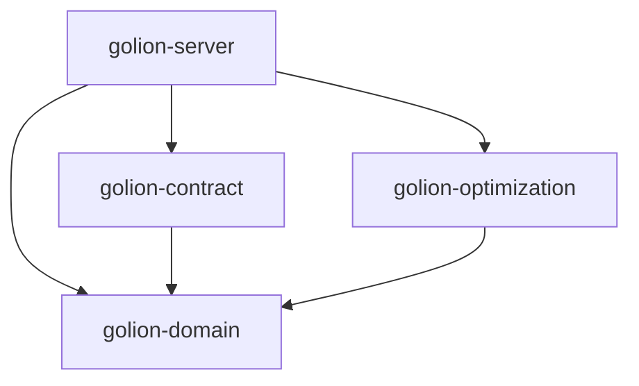

# Introduction

This document serves the purpose of a trace of architectural decisions made so we can consult them later on, challenge them and improve them.

# Architecture 29/07/2026

## Reasoning

The current architecture aims at following the hexagonal architecture pattern. Although project
is still quite small and it may lead to some slower feature integration at first, i chose this architecture for two main reasons:

- This project serves a learning ground to get proficient at rust programming language by doing a complex project . It will eventually need this kind of architecture or similar.

- This project is also a learning ground to get proficient at hexagonal architecture by implementing it from scratch and making mistakes along the way and adjusting to master it. Working in projects that do implement it and implementing it are two different skill.

## Current Structure

1- domain crate contains business logic and definitions.
2- contract contains API structs and dtos .It will contain also the conversion logic to domain structs
3- optimization crate contains optimization logic (contains dependency to modeling crate good_lp and solver highs)
4- server crate contains Axum API definitions.

## Dependency graph

Each arrow points from a crate to a crate it depends on.

## Future work

- Continue integrating crucial elements to project and implement the link between crates.
- Continue adding ports for domain through traits as the project continue to evolve.
- Improve and restructure as projects grows.

# Architecture 30/10/2026

## Ports and adapters

- `golion-domain` defines the `Optimizer` port: it takes an `OptimizationProblem` and
  returns an `OptimizationOutcome`.
- `golion-optimization` implements it with `HighsOptimizer`. It is the only crate that
  depends on `good_lp` and HiGHS.
- `golion-contract` converts the request into an `OptimizationProblem` and the outcome
  into the response.
- `golion-server` is the composition root: it chooses `HighsOptimizer` and runs the solve
  on tokio's blocking pool.
